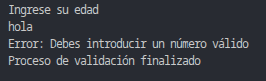
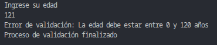
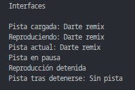

# Evidencia - Excepciones e Interfaces en C#

Aplicación de consola en C# que implementa manejo de excepciones (`try`, `catch`, `finally`, `throw` y excepciones personalizadas) junto con la interfaz `IMediaPlayer` y la clase `MusicPlayer`.

## Estructura del proyecto

- `Program.cs`: Punto de entrada y pruebas en consola.
- `Exepciones.cs`: Definición de excepción personalizada.
- `Interfaces.cs`: Definición de `IMediaPlayer` e implementación de `MusicPlayer`.

## Capturas de pantalla

### Validación y excepciones en consola
FormatException
 

EdadInvalidaException
 

### Reproductor con interfaz `IMediaPlayer`
Resultado en consola

